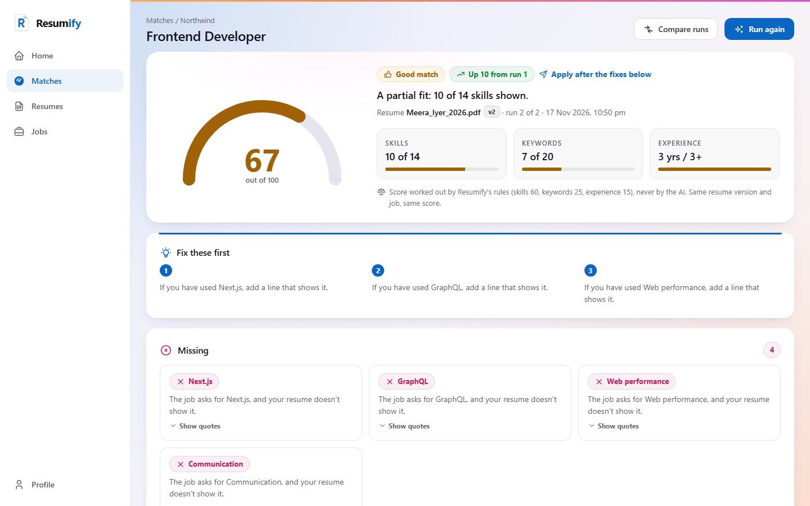
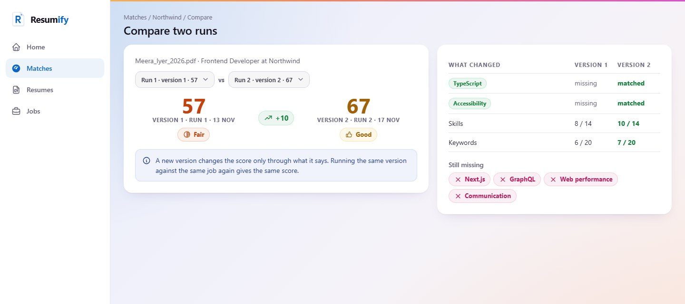

# Resumify

[](https://github.com/Pavithiran21/Resumify/actions/workflows/ci.yml)

**Live demo: [resumify-pavithiran.onrender.com/demo](https://resumify-pavithiran.onrender.com/demo)** (log in as the demo user in one click). It runs on free hosting, so the first load after a quiet spell can take about a minute.

A resume-to-job matcher that explains its answer. You upload a resume, paste or upload a job description, and Resumify scores the match. It lists the skills you have and the ones you are missing, each with the line from the resume or the job that proves it, and suggests what to improve.

**Python 3.15 · FastAPI · MongoDB (PyMongo async) · LLM (OpenAI-compatible, Groq) · React 19 · TanStack Query · Tailwind CSS 4 · Playwright**



**What's hard here**

- **The score is computed, never generated.** Deterministic rules find the job's skills and keywords, and `compute_score()` weighs skills 60, keywords 25 and experience 15. The model never gives the number, and the same resume and job reuse the stored AI answer, so the same inputs always give the same score ([matching.py](backend/app/core/matching.py)).
- **The AI must prove what it says.** The model only answers what the rules can't see, such as skills written in other words. It may move a skill to "matched" only with a quote, and that quote is checked against the resume text, so an invented one is dropped ([match_assessment.py](backend/app/services/match_assessment.py)).
- **Saving is race-safe.** A match is saved in one MongoDB transaction. A resume that got a new version while the model was thinking is refused with 409, and run numbers are counted inside the transaction, so parallel runs can't both be "run 2" ([match_service.py](backend/app/services/match_service.py)).



## Signature feature: a scored, explainable and reproducible match

Most matchers give one opaque number. Resumify combines deterministic text rules with an AI model, and keeps the model away from the score. The rules live in `backend/app/core/matching.py`:

1. **Rules first.** `analyse()` finds the job's skills using a skills dictionary, checks which ones the resume names word for word, extracts the job's keywords, and reads the years of experience the job asks for.
2. **AI for what rules can't see.** The model is asked only about the skills the resume doesn't name literally (for example "built REST services" for *API design*), extra skills the dictionary missed, and the candidate's years of experience (`backend/app/services/match_assessment.py`).
3. **The AI must quote its evidence.** `combine()` lets the model move a skill to "matched" only by quoting the resume, and that quote is **checked against the resume text**. An extra skill must quote the job the same way. An answer the model invented is dropped.
4. **The score is computed, never generated.** `compute_score()` weighs skills 60, keywords 25 and experience 15. The model never gives the number, and an identical resume and job for the same user reuse the stored AI answer, so **the same inputs always give the same score**. The verdict bands are: 85 and above perfect, 60 good, 40 fair, below that weak.

Saving is safe too. A match is saved in one MongoDB transaction together with a write to its resume and job. A resume that got a new version while the model was thinking is refused with 409 (`RESUME_CHANGED`), and run numbers are counted inside the transaction, so two runs saved together can't both be "run 2" (`backend/app/services/match_service.py`).

## Features

- Register, log in (with "keep me logged in"), profile, password reset by email, delete my account
- Several resumes, each with versions; PDF or DOCX up to 5 MB, stored in MongoDB, with the real type checked from the file's first bytes; text extracted on the server (pypdf, python-docx)
- Job descriptions pasted or uploaded as TXT, PDF or DOCX. Only the text is kept, not the file.
- Match result: score and verdict, matched and missing skills with quoted reasons, keywords, experience check, suggestions
- Match history and **compare** two runs of the same resume against the same job
- Resume text and files are private to their owner and never written to logs

## Roles

One role, **User**. Every resume, job and match is scoped to its owner; another user's id answers 404.

## Tech stack

| Layer | Choice |
|-------|--------|
| Backend | Python 3.15, FastAPI 0.162, Uvicorn, PyMongo 4.19 (async API, MongoDB Atlas), Pydantic Settings, PyJWT, bcrypt, httpx, pypdf, python-docx, `limits`, aiosmtplib |
| AI model | Any OpenAI-compatible chat API; built against Groq's free tier (`openai/gpt-oss-120b`), with a timeout and one retry that honours `Retry-After` |
| Frontend | React 19, Vite 8, React Router 8, TanStack Query 5, React Hook Form + Zod, Tailwind CSS 4, Tabler icons |
| Email | Any SMTP server: Ethereal for development, Brevo for real mail |

## Project structure

```
backend/
  app/
    core/          matching (the rules), skills, phrases, stopwords, text_extraction,
                   file_types, database, auth, rate_limit, errors
    clients/       llm_client.py (the only place that calls the model)
    services/      match_service, match_assessment (prompt + answer checks), resume, job, auth
    repositories/  MongoDB queries
    routers/       auth, profile, resumes, jobs, uploads, matches
  scripts/         seed_dev, seed_demo, seed_test, make_env, sample_files, demo_inbox, drop_database
frontend/src/      api/ auth/ features/ components/ layout/ ...
e2e/               Playwright: tests/api and tests/ui, mocks/llm-stub.js (the model stand-in), prepare.js
.github/workflows/ CI: lint, build, the Playwright suite against MongoDB 8, and the Docker image
Dockerfile         one image: FastAPI also serves the built frontend (one origin; app/core/frontend.py)
```

## Run locally

**You need** Python 3.15, Node 26, a MongoDB Atlas free (M0) cluster, and a key for an OpenAI-compatible model API (a free Groq key works).

Create `backend/.env`:

| Variable | What it is |
|----------|------------|
| `APP_ENV` | `development`, `test` or `production` |
| `PORT` | API port (4000) |
| `LOG_LEVEL` | Log level (`warning`) |
| `MONGODB_URI` | Atlas connection string; its path names the database (`…/resumify`) |
| `JWT_SECRET` | Signs access tokens (at least 32 characters) |
| `FRONTEND_URL` | `http://localhost:5173`, used in email links and CORS |
| `SMTP_HOST`, `SMTP_PORT`, `SMTP_USER`, `SMTP_PASS`, `SMTP_FROM` | Outgoing mail |
| `LLM_BASE_URL` | Model API base URL (`https://api.groq.com/openai/v1`, or a mock server) |
| `LLM_MODEL` | Model name (`openai/gpt-oss-120b`) |
| `LLM_API_KEY` | Model API key |
| `LLM_REASONING_EFFORT` | `low`, `medium`, `high`, or empty for models without it |
| `RATE_LIMITS_ENABLED` | `true` (log-in, reset, upload and match limits) |
| `DEMO_MODE` | `true` enables the `/demo` page |
| `DEMO_PASSWORD` | Password given to the seeded dev and demo accounts |
| `DEMO_SMTP_HOST`, `DEMO_SMTP_PORT`, `DEMO_SMTP_USER`, `DEMO_SMTP_PASS` | Inbox for mail to `.test` addresses, so demo mail never goes to a real server |
| `STATIC_DIR` | Optional. A built `frontend/dist`; FastAPI then serves the app too (the Docker image sets it) |

Then:

```powershell
cd backend
py -3.15 -m venv .venv
.\.venv\Scripts\python.exe -m pip install -r requirements.txt
.\.venv\Scripts\python.exe -m scripts.seed_dev          # runs real matches, so the model API is called
.\.venv\Scripts\python.exe -m uvicorn app.main:app --host 127.0.0.1 --port 4000
# API docs: http://127.0.0.1:4000/api/docs

cd ..\frontend
npm ci
npm run dev                                             # app on http://localhost:5173 (Vite proxies /api)
```

Log in is the start page (`/`). After logging in you land on `/home`.

**Or with Docker** (MongoDB included; you only need a model API key):

```powershell
$env:LLM_API_KEY='<a free Groq key>'
docker compose up --build
docker compose exec app python -m scripts.seed_demo   # then open http://localhost:4000/demo
```

## Demo accounts

With `DEMO_MODE=true`, open **http://localhost:5173/demo** and choose **Log in as User** or **Log in as Second user**. The password is the one you set in `DEMO_PASSWORD`.

| Role | Email | What to try |
|------|-------|-------------|
| User | `user@demo.resumify.test` | Open a saved match and read the quoted reasons, run a new match, compare two runs of the same resume and job (same inputs, same score), upload a new resume version. Blocked: a match of `other@demo.resumify.test` opened by its id gives "not found". |
| Second user | `other@demo.resumify.test` | Arjun's own, separate data (one resume, one job, one match). Meera's resumes, jobs and matches are not visible to him, and his are not visible to her. |

Demo accounts cannot change their email or password or delete themselves.

## Testing

**Playwright only**, in [`e2e/`](e2e): API tests with Playwright's `request` client and browser tests, against a real MongoDB (`resumify_test`) and a real Ethereal inbox. The model is replaced by a small stand-in ([`e2e/mocks/llm-stub.js`](e2e/mocks/llm-stub.js)) that answers like a careful model, quoting the resume, so results are fixed and no quota is spent. The resumes and jobs are real PDF and DOCX files, made by the backend's own `scripts.sample_files`. CI runs everything on every push.

- **18 tests**: 14 API and 4 browser.
- **Explainable:** every matched skill's quote appears word for word in the resume, and every skill has a reason. A skill shown "in other words" is matched by the AI only with a real quote. When the stand-in model invents quotes for every missing skill, they are all dropped and the score doesn't move.
- **Reproducible:** the same resume and job give the same score, the stored AI answer is reused (`assessmentReused`), and the stand-in counts one model call. A new resume version moves TypeScript from missing to matched, and Compare shows the score change.
- **Race-safe:** three runs saved at the same moment get run numbers 1, 2 and 3. A resume changed while the model was thinking gets 409 `RESUME_CHANGED`, and a model outage gets 502. Neither saves anything.
- **Uploads:** the type comes from the first bytes (a renamed text file gets 415). A password-protected PDF, a scan with no text, a 31-page PDF and a DOCX "zip bomb" are refused. A job is read from a DOCX on the server.
- **Privacy and accounts:** another user's resume, file, job and match answer 404. A wrong password and an unknown email get the same 401. A demo account can't change its password.
- **Browser and email:** a match page with its score and skills, Compare two runs, sign-in redirects, and a password reset through the emailed link.

```powershell
cd e2e
npm ci
npx playwright install chromium
npm test        # writes backend/.env.test, the fixtures and the seeded accounts, starts the stand-in model, the API and the app
```

## Deploy

The frontend runs on [Vercel](https://vercel.com) and the API on [Render](https://render.com), and the browser still sees one origin: [`frontend/vercel.json`](frontend/vercel.json) forwards `/api/*` to the Render service, so the cookies (SameSite=Strict) work with no CORS or cross-site cookies.

- **Frontend (Vercel):** import the repository, set the Root Directory to `frontend` (framework Vite, build `npm run build`, output `dist`). `vercel.json` also sends every other path to `index.html` for React Router and sets the page's security headers. If the Render service is renamed, change its URL in `vercel.json`.
- **API (Render):** one free web service from `Dockerfile.api` (see [`render.yaml`](render.yaml)). The full `Dockerfile` (API plus built frontend on one origin) is what `docker-compose.yml` and CI use.

- **Database:** MongoDB Atlas free M0, database `resumify_demo` (a replica set, which the match transaction needs; allow Render's outbound IPs under Network Access).
- **Settings:** `APP_ENV=production`, `FORWARDED_ALLOW_IPS=*` (uvicorn then trusts Render's proxy, so rate limits see the visitor's IP), `DEMO_MODE=true`, `FRONTEND_URL` = the Vercel URL, `LLM_API_KEY` (Groq), and SMTP plus `DEMO_SMTP_*`.
- **Demo data:** run `python -m scripts.seed_demo` once from the service's Shell (it calls the model for the sample matches).

## Demo videos

- `Resumify-full-workflow.webm`: sign-up, a resume against a pasted job (every skill with its reason), "Run again" giving the same score, a new resume version and Compare (+13), a job read from a DOCX file, and password reset
- `Resumify-user-demo.webm`: the User role walkthrough

<!-- To embed: edit this README on GitHub and drag the .webm files from the workspace videos/ folder here. -->

## License

Copyright (c) 2026 R.Pavithiran. All rights reserved. The source is public so you can read it and see how it is built. Please ask before copying, reusing or redistributing it.
